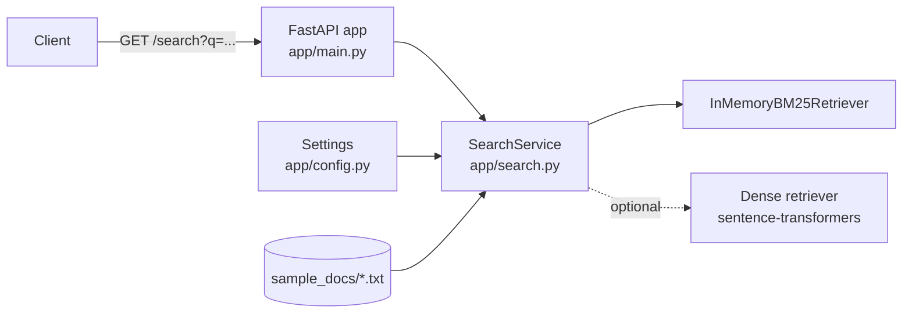

# Architecture — Haystack Search API

## Components

| File | Responsibility |
| ---- | -------------- |
| `app/main.py` | HTTP layer: routes, input validation, status codes, logging, thread-safe lazy start-up |
| `app/search.py` | Haystack logic: load documents, clean and split into chunks, index, retrieve |
| `app/config.py` | Read and validate environment variables once into a `Settings` object |
| `sample_docs/` | Five short original documents, used for the demo and the tests |

## Request flow

1. `GET /search?q=term frequency&mode=bm25&top_k=3`
2. FastAPI validates `q` (2–300 characters), `mode` (`bm25` or `dense`) and `top_k` (1–10).
3. The query is stripped; if fewer than 2 characters remain the API returns 422.
4. `SearchService.search` runs the retriever and returns chunks with source and score.
5. The API logs mode, `top_k`, hit count and latency (not the query text) and returns JSON.

## Start-up

The index is built once in the application's lifespan hook, so the health check
passes only after the documents are indexed. A missing or empty documents
folder stops start-up with a clear `NoDocumentsError`.

## Configuration

| Variable | Default | Meaning |
| -------- | ------- | ------- |
| `DOCS_DIR` | `sample_docs` | folder of `.txt` files (relative paths resolve against the project root) |
| `ENABLE_DENSE` | off | `1`, `true`, `yes` or `on` enables `mode=dense` |
| `EMBED_MODEL` | `sentence-transformers/all-MiniLM-L6-v2` | embedding model for dense mode |
| `CHUNK_WORDS` | 150 | words per chunk |
| `CHUNK_OVERLAP` | 20 | overlapping words, must be smaller than `CHUNK_WORDS` |

## Design decisions

- **Retrieval only, no reader.** The extractive reader needs PyTorch and is too heavy for a small instance.
- **In-memory index.** The corpus is tiny; rebuilding at start-up is simpler than persistence.
- **Injected service.** `create_app(service)` lets tests replace Haystack with a fake.

## Known limitations

- Dense mode needs PyTorch and keeps a second copy of the chunks in memory.
- No authentication or rate limiting.
- The index is rebuilt on every start; there is no upload or re-index endpoint.
